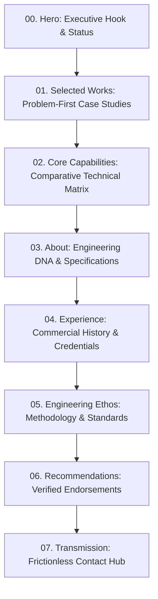

# Master Re-Plan: Safvan Khalifa Portfolio (`safvan-dev`)
### Ground-Up Architecture Governed by `ui-ux-ideology.md`

---

## 1. Core Strategic Objectives & Ideology Foundation

This plan re-derives the entire portfolio architecture from the ground up using the governing principles established in `ui-ux-ideology.md`. It rejects arbitrary aesthetic choices in favor of proven engineering and UX hiring realities.

### 1.1 The Dual-Velocity Operating Principle (Ideology Section 1)
The portfolio is designed to satisfy two opposing user personas simultaneously:
1. **The 30-Second Screener (US/Global Technical Recruiters)**: Needs immediate answers to: *Who is this? What is his core stack? What is his relocation status? What scale has he handled? Can I see live demos and code immediately?*
2. **The 45-Minute Evaluator (Engineering Directors & Hiring Committees)**: Needs deep verification of: *How does he solve problems? What architectural trade-offs did he make? What was his individual contribution? How does he verify code quality?*

### 1.2 Target Positioning & Relocation Focus
* **Candidate**: Safvan Khalifa — Full Stack Developer (MERN Native Core) & Systems Programmer (Rust, Kotlin, Linux).
* **Commercial Tenure**: 3+ Years verified professional experience.
* **Strategic Window**: Relocating to **Boston Suburbs, Massachusetts, USA — Early 2027**.

---

## 2. Full Site Map & Section Execution Order

### 2.1 Re-Derived Section Sequence
*Governed by Ideology Section 2 ("The Proof-First Mandate") and Section 3 ("Structural Blueprint").*

### 2.2 Rationale for Sequence Shift (Comparison with Previous Session)
* **Major Change: Selected Works promoted to Section 01 (Immediately following Hero)**:
  * *Ideology Rule*: Rule #1 ("Quality Over Quantity") and Rule #3 ("Proof-First Architecture" — Cake.me, Useme, roadmap.sh).
  * *Why*: In earlier sessions, Works was Section 03, buried beneath About and the Skills Matrix. A recruiter scanning in 30 seconds should never scroll 1,500px before seeing real code. Leading with case studies proves competency immediately.
* **Core Capabilities (Skills) placed at Section 02 (Immediately following Works)**:
  * *Ideology Rule*: Contextual Verification (Dev.to, van Schneider).
  * *Why*: Listing skills before work feels like unverified claims. Placed immediately after the case studies, the skills matrix acts as a structured technical inventory of tools already observed in action.
* **About moved to Section 03 (The Human & Academic Anchor)**:
  * *Ideology Rule*: Van Schneider Rule ("The About Section as Personal Glue").
  * *Why*: After technical competence and skills are established, the About section provides personal context, academic degree credentials, and work ethic.
* **Experience & Credentials at Section 04**:
  * *Ideology Rule*: Commercial Reliability (WDC, Cake.me). Chronological proof of employment and promotion track record.
* **Methodology at Section 05 & Recommendations at Section 06**:
  * *Ideology Rule*: Senior Engineering Maturity & Social Proof (Narasimhan, Webflow).
* **Transmission at Section 07**:
  * *Ideology Rule*: Anti-Gate / Frictionless Conversion (Cake.me, Dev.to).

---

## 3. Case Study Architecture (Applied Across All Projects)

*Governed by Ideology Section 4 ("Storytelling & Process: The Anti-Clutter Doctrine").*

Every project in the portfolio adheres strictly to a **dual-layer case study template**:

### 3.1 Layer 1: The 30-Second Executive Spec Box (Macro-Scan)
* **Title & Classification**: `[INDEX 0X] Project Name // Category`
* **Role & Contribution Boundary**: Exact individual role (Solo Full Stack / Backend Lead).
* **Lead Production Stack**: 3–5 core technologies.
* **Primary Key Impact Metric**: Quantitative outcome (e.g. `500+ Req/s | -45% DB Latency`).

### 3.2 Layer 2: The 4-Part Retrospective Narrative (Micro-Deep Dive)
1. **The Operational Bottleneck / Problem**: The specific business failure, architectural bottleneck, or user friction that necessitated the project.
2. **Constraints & Technical Trade-offs**: Deadlines, zero-budget server limits, legacy database schemas, or bare-metal memory constraints.
3. **Architectural Solution & Decisions**: What was actually built, why technology X was chosen over technology Y, and the core algorithms or schema optimizations applied.
4. **Quantified Outcome**: Measured performance delta, latency reduction, throughput scaling, or compliance metric.
5. **Dual Action Verification**: Direct GitHub source code button + Live platform demo link.

---

## 4. Policy on Process Artifacts: Surfacing vs. Omitting

*Governed by Ideology Section 4 ("The Anti-Clutter Rule" vs. "The Substantive Pivot Rule").*

### 4.1 What is Strictly Banned (Left Out)
* **NO Post-it note workshop photos** or whiteboard collages (signals bootcamp clichés).
* **NO Generic Double Diamond diagrams** or textbook design-thinking flowcharts.
* **NO Fictional user personas** ("Meet John, a 30-year-old manager who wants efficiency").
* **NO Low-fidelity sketch collages** that contain no architectural decisions.

### 4.2 What is Surfaced (Mandated)
* **Substantive Architectural Decisions**: Concrete rationale for architectural pivots (e.g., *Why MySQL stored procedures replaced ORM queries*, *Why Jetpack Compose replaced Android XML views*, *Why #![no_std] bare-metal Rust was chosen for UEFI bootloader*).
* **Performance Benchmarks & Deltas**: Measurable performance jumps (-45% latency, 60 FPS Compose rendering, 180MB dependency reduction).
* **System Audit Spec Ledgers**: Technical tabular metadata verifying classification, memory model, test coverage, and deployment target.

---

## 5. Navigation & Interaction Flow Model

*Governed by Ideology Section 5 ("Structural Smoothness").*

* **Architecture**: **Unified Vertical Editorial Flow** within a single high-performance SPA.
* **Elimination of Horizontal Scroll-Jacking**:
  * *Previous Conflict*: Earlier sessions implemented a GSAP horizontal pinning track for works.
  * *Ideology Correction*: Replaced entirely with natural vertical scrolling featuring asymmetric flat blocks. Horizontal scroll-jacking violates accessibility standards and disrupts mouse wheel/trackpad ergonomics.
* **Persistent Structural Progress**:
  * Fixed, minimalist header with live section spy and direct resume download.
  * All sections prefixed with uppercase mono structural micro-labels: `[ 0X / SECTION NAME ]` paired with status badges.
  * Full keyboard accessibility (`Tab`, `Shift+Tab`, `Enter`, `Escape`) and `Ctrl+K` interactive terminal drawer.
  * Zero cursor lag; native OS cursor is always preserved and respected.
  * Complete support for `prefers-reduced-motion: reduce`.

---

## 6. Phased Implementation Roadmap

* **Phase 1: Re-Planning & Architecture Validation (Current Step)**
  * Rewrite `plan.md`, `sections.md`, and `layout.md`.
  * Align with `ui-ux-ideology.md` and present to user for review.
* **Phase 2: Content Rebuild (`content.md`)**
  * Re-slot raw verified resume/project facts into the 4-part case study retrospective format.
  * Insert `[TODO: need process notes for Project X]` for any missing non-fabricated details.
* **Phase 3: Design System Specification Rebuild (`design.md`)**
  * Preserve finalized two-tone palette (`#1F6B4F` green, `#F2F0EA` cream, `#141414` near-black).
  * Document visual structure for case study retrospectives and flat color blocking.
* **Phase 4: Section-by-Section Rebuild**
  1. Navigation & Structural Shell
  2. Hero Section
  3. Template Project Case Study (Build 1, get approval)
  4. Remaining Projects
  5. About & Experience Section
  6. Contact Section
