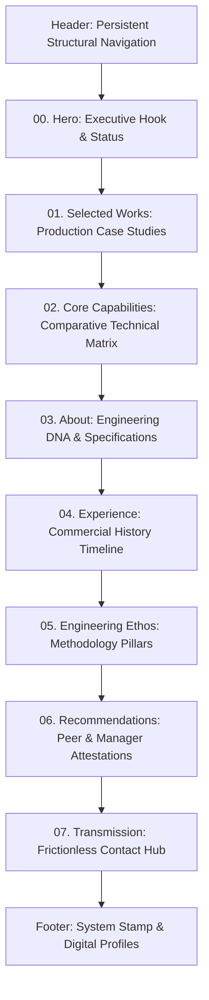

# Section-by-Section Architecture: Safvan Khalifa (`safvan-dev`)
### Ground-Up Structural Specification Governed by `ui-ux-ideology.md`

---

## 1. Top-to-Bottom Execution Flow

The portfolio follows a strict, research-backed psychological progression: **Identity → Verified Output → Technical Inventory → Personal Rigor → Commercial Track Record → Engineering Standards → Social Proof → Frictionless Contact**.

---

## 2. Detailed Section Specifications

### Section 00: Hero Section (`HeroSection`)
* **Ideology Rule**: *The Dual-Velocity Law & 5-Second Executive Hook (Ideology Section 1)*.
* **Component**: `src/sections/HeroSection/HeroSection.jsx`
* **Structural Anchor**: `#home`
* **Micro-Label**: `[ 00 / PROLOGUE: FULL STACK & SYSTEMS ]`
* **Status Badge**: `Relocating to Boston Area — Early 2027`
* **Strategic Purpose**: Instantly orient the technical recruiter. Deliver identity, target relocation date, core technical scope, and primary quantitative achievements without forcing scrolling.
* **Content Breakdown**:
  * **Oversized Display Typography**: `SAFVAN KHALIFA` in Fraunces Variable Serif (`clamp(3.75rem, 8.2vw, 7.25rem)`), weight 800, line-height 0.93.
  * **Eyebrow Micro-Label**: `↳ ENGINEERING PORTFOLIO // FULL STACK DEVELOPER & SYSTEMS PROGRAMMER`.
  * **Lead Value Proposition**: Single clear sentence: *"Full-stack developer building production web applications in the MERN stack, with systems and tooling in Rust, Kotlin, and Linux."*
  * **Visual Layering & Geometric Swoop**: Interactive 60 FPS developer avatar card framed by an inline SVG geometric swoop in Forest Green (`#1F6B4F`) with precision crosshair ticks.
  * **Verified Metrics Ledger**: 4-column flat strip spanning the hero base:
    * `3+ Years` Experience
    * `500+ Req/s` Production Scale
    * `-45% Latency` MySQL Query Tuning
    * `MERN Stack` Handcrafted Core
* **CTAs**: Primary flat button: `Explore Selected Work →` (anchors to `#works`); Secondary outline: `Get in Touch` (anchors to `#contact`).

---

### Section 01: Selected Works (`WorksSection`)
* **Ideology Rule**: *Proof-First Mandate & Asymmetric Flat-Block Layout (Ideology Section 2 & 3.4)*.
* **Component**: `src/sections/WorksSection/WorksSection.jsx`
* **Structural Anchor**: `#works`
* **Micro-Label**: `[ 01 / SELECTED WORKS: PRODUCTION CASE STUDIES ]`
* **Status Badge**: `EDITORIAL CURATION`
* **Strategic Purpose**: Place undeniable, verified software output immediately in front of the reviewer. Replaces the old Section 03 position to eliminate recruiter scroll fatigue.
* **Content Breakdown**:
  * **Dynamic Category Filter**: Tabs for `All Projects [8]`, `Web & MERN [5]`, `Systems & Mobile [3]`.
  * **Lead Flagship Feature Block (Two-Column Editorial Spread)**:
    * Left: Case Study metadata, large display title, role, prominent impact block (`⚡ ARCHITECTURAL IMPACT`), retrospective problem-solution narrative, tech badges, and dual verification buttons.
    * Right: **System Audit Spec Ledger** in solid contrasting cream (`#E8E5DC`), listing engineering classification, primary outcome, core technologies, and commercial deployment status.
  * **Asymmetric Secondary Grid (12-Column Mosaic)**:
    * Remaining projects distributed asymmetrically (`span-7`, `span-5`, `span-6`, `span-12`) using flat color blocking (`#FAF9F6` vs `#E8E5DC`).
    * Each card contains: Index, category, title, role, impact metric callout, concise retrospective summary, tech stack, and GitHub / Demo links.
* **Process Surfacing Policy**: Every case study features concrete technical decisions (e.g. *raw stored procedures vs ORM*, *Compose 60 FPS vs XML*); bans all fake whiteboard/sticky-note clutter.

---

### Section 02: Core Capabilities (`SkillsMatrixSection`)
* **Ideology Rule**: *Contextual Technical Inventory & Delineated Domains (Ideology Section 3.3)*.
* **Component**: `src/sections/SkillsMatrixSection/SkillsMatrixSection.jsx`
* **Structural Anchor**: `#skills`
* **Micro-Label**: `[ 02 / COMPARATIVE MATRIX: TECHNICAL CAPABILITIES ]`
* **Status Badge**: `DUAL-DOMAIN`
* **Strategic Purpose**: Act as a structured technical index of tools directly supporting the case studies seen in Section 01, eliminating uncontextualized "buzzword soup."
* **Content Breakdown**:
  * **Dual-Panel Architecture**:
    * **Panel 1: Native Handcrafted MERN Core (Primary Domain)**:
      * 100% unassisted code: React, Next.js, Node.js, Express, MongoDB, MySQL, Stored Procedures, Schema Optimization, State Isolation.
      * Includes inline performance notes (`// MySQL: -45% latency via indexed stored procedures`).
    * **Panel 2: Systems & Mobile Tooling (AI-Augmented & Native Systems)**:
      * Low-level systems and tooling: Rust 2024 (`#![no_std]`), Android Jetpack Compose, Linux CachyOS/Wayland, Electron DRM.
  * **Flat Styling**: Solid surface backgrounds, hairline division grids, and 0px drop shadows.

---

### Section 03: About & Engineering DNA (`AboutSection`)
* **Ideology Rule**: *The Personal Anchor & Culture Fit (Ideology Section 3.2 — Tobias van Schneider Rule)*.
* **Component**: `src/sections/AboutSection/AboutSection.jsx`
* **Structural Anchor**: `#about`
* **Micro-Label**: `[ 03 / BIOGRAPHY & ARCHITECTURAL SPECS ]`
* **Status Badge**: `PROFILE VERIFIED`
* **Strategic Purpose**: Ground technical skills in human reality, personal discipline, and formal academic rigor.
* **Content Breakdown**:
  * **Left: Narrative Craftsmanship**: Concise 1-paragraph biographical overview detailing commercial experience, dual-domain philosophy, and Boston early-2027 relocation.
  * **Right: Architectural Blueprint Card**: Monospace specification ledger containing:
    * `ACADEMIC DEGREE`: B.Tech in Computer Engineering (GDEC, Abrama | CGPA: 7.84 / 10.0)
    * `COMMERCIAL EXPERIENCE`: 3+ Years Production
    * `PRIMARY FOCUS`: React, Node.js, Express, MongoDB, MySQL
    * `SYSTEMS DOMAIN`: Rust 2024, Kotlin Compose, Linux
    * `RELOCATION TARGET`: Boston Suburbs, MA (Early 2027)
    * `PERSONAL DISCIPLINES`: Weightlifting, Culinary Precision, Linux Rice

---

### Section 04: Experience & Credentials (`ExperienceSection`)
* **Ideology Rule**: *Commercial Reliability & Chronological Track Record (Ideology Section 3.5 — WDC, Cake.me)*.
* **Component**: `src/sections/ExperienceSection/ExperienceSection.jsx`
* **Structural Anchor**: `#experience`
* **Micro-Label**: `[ 04 / COMMERCIAL WORK HISTORY & CREDENTIALS ]`
* **Status Badge**: `VERIFIED RESUME DATA`
* **Strategic Purpose**: Detail formal employment tenure, rapid promotion history, and accredited academic degrees.
* **Content Breakdown**:
  * **Vertical Connected Timeline**:
    1. *MarketingSolver.in, Navsari* (Aug '24 – Aug '25) — Web Developer (Full Stack MERN)
    2. *La Net Team, Surat* (Jul '22 – Jul '24) — Software Developer (Enterprise MERN)
    3. *La Net Team, Surat* (Jan '22 – Jul '22) — Software Developer Trainee (Promotion on completion)
  * **Right Sidebar: Accredited Credentials**:
    * Bachelor of Technology in Computer Engineering (GDEC, Abrama | CGPA: 7.84)
    * Full-Stack Web Development Certification (Dr. Angela Yu | 62 Hours)

---

### Section 05: Engineering Ethos (`MethodologySection`)
* **Ideology Rule**: *Senior Engineering Maturity & The Definition of Done (Ideology Section 3.6 — Narasimhan)*.
* **Component**: `src/sections/MethodologySection/MethodologySection.jsx`
* **Structural Anchor**: `#methodology`
* **Micro-Label**: `[ 05 / ENGINEERING ETHOS: METHODOLOGY & PILLARS ]`
* **Status Badge**: `PRACTICAL STANDARDS`
* **Strategic Purpose**: Articulate the rigorous quality and verification standards applied to every commit.
* **Content Breakdown**:
  * **Pillar 01**: The Definition of "Done" (Automated tests, hardware profiling, documentation).
  * **Pillar 02**: Separation of Concerns (State isolation, modular API contracts, zero leaky abstractions).
  * **Pillar 03**: Performance as a Feature (Sub-100ms API targets, 60 FPS mobile rendering, memory leak audits).

---

### Section 06: Recommendations (`TestimonialsSection`)
* **Ideology Rule**: *Contextual Social Proof & Risk Elimination (Ideology Section 3.7 — Webflow, WDC)*.
* **Component**: `src/sections/TestimonialsSection/TestimonialsSection.jsx`
* **Structural Anchor**: `#testimonials`
* **Micro-Label**: `[ 06 / RECOMMENDATIONS: MANAGERS & PEERS ]`
* **Status Badge**: `VERIFIED ATTESTATIONS`
* **Strategic Purpose**: Eliminate corporate hiring risk via direct peer and manager endorsements.
* **Content Breakdown**:
  * Direct verified quotes from:
    1. *Damini Choat* — Direct Manager & HR Specialist at La Net Team Software Solution.
    2. *Abhishek Jariwala* — Full Stack Engineer (Colleague at La Net Team).
    3. *Shrey Jariwala* — Software Developer (Colleague at La Net Team).
  * Direct LinkedIn button triggers for every reference.

---

### Section 07: Transmission (`ContactSection`)
* **Ideology Rule**: *Frictionless Conversion & Anti-Gate (Ideology Section 3.8 — Cake.me, Dev.to)*.
* **Component**: `src/sections/ContactSection/ContactSection.jsx`
* **Structural Anchor**: `#contact`
* **Micro-Label**: `[ 07 / TRANSMISSION: GET IN TOUCH ]`
* **Status Badge**: `OPEN FOR OPPORTUNITIES`
* **Strategic Purpose**: Make reaching out completely effortless.
* **Content Breakdown**:
  * One-click email copy button with toast notification (`khalifasafvan@yahoo.com`).
  * Direct phone link protocol (`tel:+918153837262`).
  * Direct GitHub (`khSafvan`) and LinkedIn profile links.
  * Direct PDF resume download button (`/safvan-khalifa-resume.pdf`).
  * Minimalist 4-field inquiry form (Name, Email, Subject, Message) with instant confirmation toast.

---

### Global Header & Footer
* **Header**: Sticky minimalist bar with prompt badge (`zack@ghost:~$`), live section scroll-spy, resume trigger, and interactive terminal trigger (`Ctrl+K`).
* **Footer**: System stamp (`Host: ghost | Arch/CachyOS`), copyright, and back-to-top button.
